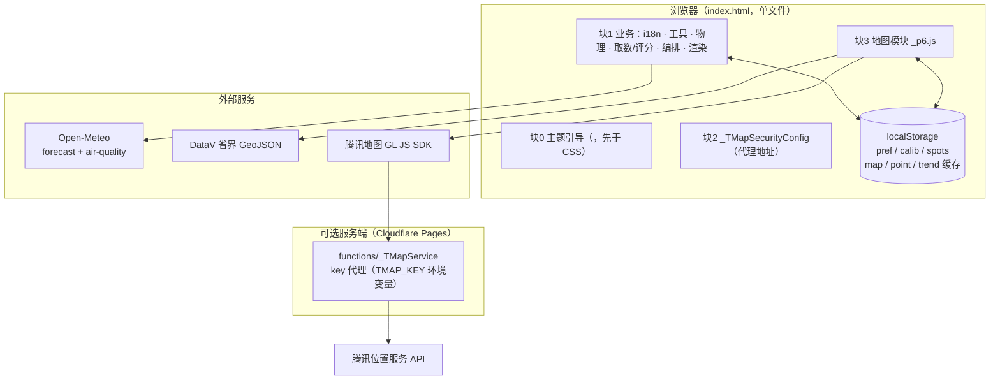

# 02 · 整体架构

## 1. 总览：三条主线

```
源码（tpl/ + _p*.js + refs/） ──assemble.py──▶ 产物（index.html / 404.html） ──静态托管──▶ 浏览器
                                                   │
                                            mkpreview.py ──▶ _check/preview.html ──▶ 回归探针（26 项）
                                                   │
                                     （PWA=1）manifest.json / sw.js / icon-*.png
```

- **构建主线**：拼装式构建，产物单向生成、禁止手改；
- **运行主线**：全部计算在浏览器本地完成，只向免费公开接口取数；地图 key 走可选同源代理；
- **验证主线**：探针跑"带 SDK 桩的预览页"，合成数据零额度，文档数字由 `docfacts` 机读对账。

## 2. 逻辑分层

| 层 | 文件 | 职责 | 副作用 |
| --- | --- | --- | --- |
| i18n 层 | `_pi18n.js` | 三语词典、`i18n()`、语言优先级、DOM 静态改写 | DOM |
| 工具/安全层 | `_p2.js` | 数学/日期/天文工具、`esc`/`safeLabel`、base64url、城市检索 | 无 |
| 物理模型层 | `_p3.js` | 气溶胶/光路消光、CIE 光追成色、云层参数化、火烧云几何 | 无 |
| 数据+评分层 | `_p4.js` | Open-Meteo 取数（含重试/记账）、`scoreStat`/`scoreRay`、等级与色阶唯一来源 | 网络 |
| 编排层 | `_p5.js` | `State`、初始化、事件、`computeAll`、趋势/对比/校准/快照 | DOM/存储/网络 |
| 渲染层 | `_p5b.js` | 结论卡/模型卡/因素表/光追卡/注记/快照卡/分享卡 canvas | DOM |
| 地图层 | `_p6.js` | 局部网格取数、值场插值自绘、图层/榜单/提示卡/下钻、三套缓存 | DOM/存储/网络 |
| 版式层 | `tpl/template.html` | HTML 骨架 + CSS 设计令牌 + 4 个内联脚本块 | — |

> **共享全局作用域**：`_pi18n → _p2 → _p3 → _p4 → _p5 → _p5b` 拼进同一个 `<script>` 块，
> `_p6.js` 单独一块且**最后执行**。`function` 声明同名会**静默覆盖**（约束 28），因此新增全局函数必须先跨文件 grep。

## 3. 构建流水线（assemble.py）

### 3.1 输入 → 输出

| 输入 | 输出 |
| --- | --- |
| `tpl/template.html` + `_pi18n.js,_p2.js,_p3.js,_p4.js,_p5.js,_p5b.js,_p6.js` + `refs/{CN,MAP,GLOBAL}_CITIES_RAW.txt`、`GL_ALIAS_RAW.txt`、`ELEV_GRID_RAW.txt` | `index.html` |
| `tpl/404.html` | `404.html` |
| `PWA=1` 时额外 | `manifest.json`、`sw.js`、`icon-192.png`、`icon-512.png` |

### 3.2 模板的 4 个内联脚本块

| 块序 | 模板位置 | 内容 | 构建动作 |
| --- | --- | --- | --- |
| 0 | `<head>` 内、`<style>` 之前（template.html:30） | 主题引导脚本（防 FOUC，**必须早于 CSS**） | 模板自带 |
| 1 | template.html:1665（占位 `/*__BLOCK0__*/`） | 业务代码 | `_pi18n + _p2 + _p3 + _p4 + _p5 + _p5b` 按序拼接注入 |
| 2 | template.html:1691 | `window._TMapSecurityConfig.serviceHost` 地图代理配置 | 占位符 `__TMAP_SERVICE_HOST__` 替换 |
| 3 | template.html:1706（占位 `/*__BLOCK2__*/`） | 地图模块 `_p6.js` | 注入前先替换 `/*__ELEV_GRID__*/` 高程数据 |

⚠️ **命名陷阱**：占位标记叫 `__BLOCK0__` / `__BLOCK2__`，但它们位于第 **2** 个和第 **4** 个内联块（索引 1 / 3）。
历史命名，读代码时以"块序号 0–3"为准。`assemble.py:243` 断言内联块恰为 4 个，外部 SDK `<script src>` 不计入。

### 3.3 占位符替换表

| 占位符 | 注入内容 | 备注 |
| --- | --- | --- |
| `/*__CN_CITIES__*/` 等 4 个 | `refs/*.txt` 城市/别名表 | 每个必须恰出现 1 次，否则构建失败 |
| `/*__ELEV_GRID__*/` | `refs/ELEV_GRID_RAW.txt`（base64 高程网格） | **可选**：缺失则保留占位符、前端 `ELEV=null` 退化 |
| `__TMAP_SERVICE_HOST__` | 地图代理地址 | 未设 `TMAP_SERVICE_HOST` 时回落本地预览占位形态 |
| `__SITE_BASE__` | 站点根绝对路径 | 仅 404 模板；GitHub Pages 子路径部署用 |
| `__ICON_SVG__` / `__ICON_PNG180__` | favicon / touch icon | 纯 stdlib 生成，无 Pillow |
| `<!--__PWA_HEAD__-->` | manifest `<link>` | 仅 `PWA=1`；SW 注册脚本由 `_p5.js initPWA` 从 link href 推导 |

所有替换共守一条出厂纪律：**占位符不允许残留**（构建末尾双重校验）。

### 3.4 构建期不变量

- 内联块数 = 4（`assemble.py:243` 断言）；
- 块 1 的片段集合必须恰为 `PARTS[:-1]`（`assemble.py:207` 结构守卫，防片段被静默丢出产物）；
- SW 缓存名 = 产物 `index.html` 字节的 **sha256 前 12 位**（`assemble.py:304`），内容变则旧缓存自动作废。

## 4. 运行时架构



运行时特征：

- **全部计算在浏览器本地完成**（天文、物理光追、评分、插值、绘图），服务端只做 key 代理；
- 页面无前端路由，"未知路径"由托管平台返回 `404.html`（404 状态码约定）；
- `PWA=1` 构建时 Service Worker 只预缓存同源静态壳，**绝不缓存气象响应**（过期预报比没有预报更危险）。

## 5. 四大核心数据流

### 5.1 单点预报链（`runForecast` → `computeAll` → `renderAll`）

```
runForecast(_p5:1058)            并发排队（busy/pending 补跑）
 └─ computeAll(_p5:1130)
     ├─ 天文：sunEvents / solarPosition / sunsetSpeedKmph(_p2) + sunAltRate(_p3)
     ├─ 样带：TRANSECT(17 点,0…400km) 沿事件方位 destPoint(_p2)
     ├─ 取数：apiForecast(GFS) + apiForecast(EC) + apiAQ(_p4)   ← 两级缓存 pointCacheGet/Put(_p6)
     ├─ 要素：makeSeries 逐时插值 → buildEnv(_p4)
     ├─ 评分：primaryDeck → analyseTransect(_p3) → scoreStat(GFS/EC) → scoreRay(光追)
     ├─ 合成：wgeo 加权几何平均，W_ENS = {gfs:.30, ec:.34, rt:.36}
     └─ notes 质量提示（时效/风/偏差/缺测/沙尘…）
 └─ renderAll(_p5b:46)：hero 天色带 + 模型卡 + 因素表 + 光追卡 + 注记 + 校准块
```

### 5.2 地图链（`loadMapData` → `buildField` → `paintMap`）

```
loadMapData(force, cacheOnly) (_p6:3094)
 ├─ 快路径 A：内存 MapMod.data[date][period]
 ├─ 快路径 B：磁盘 mapCacheGet(date)
 ├─ if (cacheOnly) return false   ←「缓存自动加载零请求」的硬保证（一行）
 ├─ 取数：57 网格点 × (GFS+EC+AQ)，顺序执行 + 组间 sleep(300)；样带外点 IDW 推求不额外请求
 ├─ 逐点评分：buildEnv / analyseTransect / scoreRay / scoreStat → {p:{ens,gfs,ec,rt}, q, cld}
 └─ 提交：reqSeq 令牌校验 → 内存 + mapCachePut → paintMap()
paintMap(_p6:3475) → buildField(几何层 buildGeom + 取值层 evalField) → 条带/云纹/等值线 → fitRaster
```

### 5.3 趋势链（F5/F3）

```
loadTrend(cacheOnly)(_p5:1740) → trendCacheGet(_p6) → transectFor → apiForecast×2+apiAQ
 → computeTrend(逐日注入 bundle 复用 computeAll) → trendCachePut(只存算好的 rows≈1KB)
 → renderTrend(数值表) + renderTrendCal(日历，渲染零取数)
```

### 5.4 快照链（F5）

```
readUrl(_p5:1387) → snapDecode(解码即逐字段校验) → applySnap(快照模式)
 → renderSnap(_p5b:517，零取数；日出日落/方位由纯天文现算，不可篡改)
分享：renderFactors 填 State.factorRows → snapEncode(只存键与数) → snapUrl
```

## 6. 缓存体系（详见 [05-依赖关系](05-依赖关系.md)）

| 键族 | 存什么 | 上限 / TTL | 淘汰策略 |
| --- | --- | --- | --- |
| `sunsetbot.map.v6.*` | 地图两时段数据集 | 磁盘 6 条 / 3h；内存 LRU 3 日期 | 当前地点 keepMine=true |
| `sunsetbot.point.v1.*` | 单点原始 bundle | 4 条 / 3h | keepMine=false |
| `sunsetbot.trend.v1.*` | 趋势算好的 rows | 3 条 / 3h | keepMine=false |
| `sunsetbot.pref.v1` | 9 项显示偏好 + 折叠态 | 不进任何 sweep | 偏好不是缓存 |
| `sunsetbot.calib.v1` | F4 标注 | 200 条上限 | 用户显式清空 |
| `sunsetbot.spots.v1` | F2 收藏机位 | 5 个 | — |

三套缓存键族统一由 `mapCacheSweep(_p6:1597)` 收口（版本残留清理 + LRU 淘汰），
口径变化必须升版本前缀（`MAP_CACHE_PREFIX` / `POINT_CACHE_PREFIX` / `TREND_CACHE_PREFIX`）。
