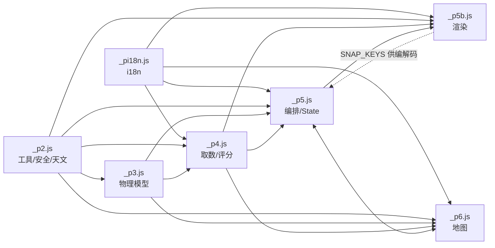

# 05 · 依赖关系

## 1. 运行时外部依赖

| 依赖 | 用途 | 调用位置 | 备注 |
| --- | --- | --- | --- |
| Open-Meteo Forecast API `https://api.open-meteo.com/v1/forecast` | 气象预报（GFS seamless / ECMWF-IFS025） | `_p4.js:4` `API_FORECAST` | 免费公开、无需注册；额度按**访客出口 IP**（约 10,000/天/人） |
| Open-Meteo Air Quality API `https://air-quality-api.open-meteo.com/v1/air-quality` | CAMS 气溶胶（AOD / pm2.5 / dust） | `_p4.js:5` `API_AQ` | 失败时按 AOD=0.25 降级 |
| 阿里云 DataV 省界 GeoJSON `https://geo.datav.aliyun.com/areas_v3/bound/100000_full.json` | 海陆掩膜、省份下钻、省级色块降级 | `_p6.js:679` | 省份名来自此文件（外部数据 ⇒ 必须 `esc()`） |
| 腾讯地图 GL JS SDK `https://map.qq.com/api/gljs…` | 底图、投影、Heat 语义参照 | `tpl/template.html:1705`（外链，唯一跨域脚本） | key 不进产物，走同源代理 |
| 腾讯位置服务 API（4 条上游） | SDK 实际数据（瓦片/搜索等） | `functions/_TMapService/[[path]].js:40-43` | `pr.map.qq.com` / `apikey.map.qq.com` / `overseactrl.map.qq.com` / `apis.map.qq.com/ws` |
| 浏览器 API | `fetch`、`localStorage`、`navigator.geolocation`、`clipboard`、`matchMedia`、`ResizeObserver`、`serviceWorker`、canvas/SVG | 各层 | 无 polyfill，面向现代浏览器 |

> **没有 npm 依赖**：产物是零依赖单文件；`package.json` 不存在是刻意的（单文件自包含约束）。

## 2. 可选服务端依赖（地图代理）

```
浏览器 SDK ──同源──▶ /_TMapService/… ──注入 TMAP_KEY──▶ 腾讯位置服务
```

- `functions/_TMapService/[[path]].js` 路由表：

| 路径段 | 上游 | key 参数名 |
| --- | --- | --- |
| （空） | `https://pr.map.qq.com/pingd?appid=jsapi_v3` | `key` |
| `checkKey` | `https://apikey.map.qq.com/mkey/index.php/mkey/check` | `key` |
| `oversea` | `https://overseactrl.map.qq.com` | `apikey` |
| `service` | `https://apis.map.qq.com/ws`（透传子路径） | `key` |

- `TMAP_KEY` 只存在 Pages 环境变量，**永不进入产物**；同源 ⇒ 无 CORS / 无混合内容。
- 未部署代理时，前端 `isMapProxyPlaceholder()`（_p6:583）识别占位形态并显示说明文案，地图不可用但其余功能正常。

## 3. 构建期依赖

| 工具 | 用途 | 必需性 |
| --- | --- | --- |
| Python 3（仅 stdlib：zlib/struct/base64/re/hashlib） | `assemble.py` / `mkpreview.py` / `docfacts.py` 等 | 必需 |
| Node ≥ 22 | 回归探针（`fetch`、`WebSocket` 全局） | 仅测试 |
| Chrome 桌面版 | headless + `--remote-debugging-port`（CDP） | 仅测试 |

无 Pillow、无 npm install、无 Makefile —— 构建零安装成本。

## 4. 内部模块依赖图



依赖纪律：

- 片段拼接顺序即执行顺序：`_pi18n → _p2 → _p3 → _p4 → _p5 → _p5b`（同块）、`_p6`（后块）；
- **同名全局函数会静默覆盖**（约束 28）：新增全局函数前必须跨文件 grep，`_check/globals.js` 回归守着；
- `isDarkTheme`（_p5）被 `_p4 gradeColor` 反向依赖 —— 跨片段循环依赖靠"运行期才调用"成立，纯函数自测须容忍无 DOM。

## 5. localStorage 依赖（客户端数据）

| 键 / 前缀 | 写入者 | 内容 | 上限 / TTL |
| --- | --- | --- | --- |
| `sunsetbot.pref.v1` | `_p5.js prefWrite` | 9 项显示偏好 + 5 项折叠态 + `lang`/`theme`/`calibOff` | 一键，实测约 112 B |
| `sunsetbot.calib.v1` | `_p5.js calibSave` | F4 实况标注 | 200 条（溢出丢最旧） |
| `sunsetbot.spots.v1` | `_p5.js spotsWrite` | F2 收藏机位 | 5 个 |
| `sunsetbot.map.v6.{date}@{lat,lon}` | `_p6.js mapCachePut` | 地图两时段数据集 | 磁盘 6 条 / 3h |
| `sunsetbot.point.v1.{date}\|{period}@{lat,lon}` | `_p6.js pointCachePut` | 单点原始 bundle | 4 条 / 3h |
| `sunsetbot.trend.v1.{ymd}@{lat,lon}` | `_p6.js trendCachePut` | 趋势算好的 rows（≈1 KB） | 3 条 / 3h |

共享约束：

- 5 MB 共享配额 ⇒ 趋势**只存算好的 rows**（存原始响应约 5 MB 会撑爆配额导致全部缓存静默失效）；
- 三套缓存键族统一经 `mapCacheSweep`（_p6:1597）淘汰；**偏好键族不进任何 sweep**（偏好不是缓存）；
- 口径（权重/阈值/字段）变化必须升版本前缀，`dropStalePrefixFamily` 清掉旧版本残留防"幽灵键吃满配额"；
- 教程页 `tutorial.html` 复用 `sunsetbot.pref.v1` 的 `lang`/`theme` 两个字段（只补字段、不擦别人的）。

## 6. 构建输入依赖

| 输入 | 消费者 | 缺失行为 |
| --- | --- | --- |
| `tpl/template.html` | `assemble.py` | 硬失败 |
| `_pi18n.js` … `_p6.js` | `assemble.py` | 硬失败；块 1 片段集合守卫拦截漏项 |
| `refs/CN_CITIES_RAW.txt` 等 4 份 | `assemble.py` → `_p2.js` 占位符 | 硬失败（占位符必须恰出现 1 次） |
| `refs/ELEV_GRID_RAW.txt` | `assemble.py` → `_p6.js` 占位符 | **可选**：`ELEV=null`，分段退化为整行单段 |
| `refs/p_*.txt` | 仅人工对照 / `harness.js` 断言数值溯源 | 不进产物，缺失只影响对照 |
| `index.html`（已构建产物） | `mkpreview.py` | 硬失败（必须先跑 `assemble.py`） |

## 7. 文档 ↔ 代码的锁定关系

`_check/docfacts.py` 把以下三方锁在一起（详见 [07-测试体系](07-测试体系.md)）：

```
源码常量（正则机读） ──┐
文件系统（wc -l / 字节）─┼──▶ docfacts ──▶ README.md / 阶段性总结.md 中的数字
_check/.facts.json（探针断言数 + 源码 sha1）─┘
```

因此：**改常量/行数/断言数而不改文档，回归会红**（报 STALE 或不一致）。
